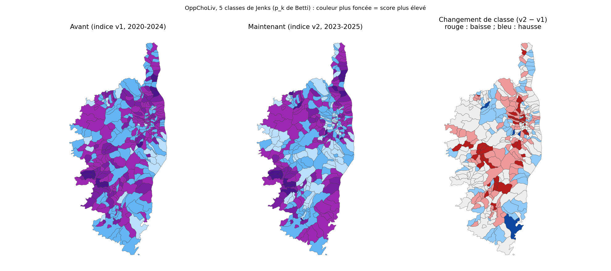

# Ancien et nouvel indice courant : ce qui change sur la carte

Rapport du 20 octobre 2026. Rédigé pour la doctorante qui pilote le projet. Objet : comparer la carte OppChoLiv de l'**indice v1** (sources de 2020 à 2024, archivé) à celle de l'**indice v2** (sources officielles de 2023 à 2025, en place depuis le 19 octobre), et expliquer d'où viennent les différences. Les deux cartes sont calculées avec les poids de Betti et al. et leurs propres seuils de Jenks à 5 classes, comme dans l'appli.

## En bref

- **La carte change nettement, sans devenir méconnaissable.** 153 communes sur 360 gardent leur classe, 159 changent d'une classe, 48 de deux classes ou plus. La corrélation de rang entre les deux indices est de 0,58.
- **La cause principale est Opp4 (la connectivité).** Remettre son ancienne valeur déplace l'indice de 0,69 point en moyenne, deux fois plus que n'importe quel autre indicateur : la 4G et la fibre de l'ancien indice n'avaient pas de source, elles sont remplacées par les mesures de l'ARCEP.
- **Les très petites communes font les plus gros écarts** (recensement 2023 contre 2020-2022, valeurs instables sur quelques dizaines d'habitants) : leur nouvelle valeur n'est pas plus fiable que l'ancienne, juste mieux sourcée.
- **Les grandes villes bougent peu**, le Sud progresse, l'intérieur (centre, Castagniccia) recule.

## Les deux cartes

Couleur plus foncée = score plus élevé (5 classes de Jenks). Troisième carte : changement de classe de chaque commune entre l'ancien et le nouvel indice (rouge : baisse, bleu : hausse, gris : inchangé).

## Ce qui a bougé

| | Indice v1 | Indice v2 |
|---|---|---|
| Seuils de Jenks (4 seuils internes, échelle 0-10) | 2,18 / 3,59 / 4,97 / 7,00 | 2,63 / 4,17 / 5,81 / 7,61 |
| Communes par classe (de la plus basse à la plus haute) | 23 / 115 / 145 / 65 / 12 | 78 / 100 / 118 / 46 / 18 |
| Poids de Betti (Opp / Cho / Vec) | 0,458 / 0,235 / 0,307 | 0,491 / 0,186 / 0,323 |

Les seuils de Jenks montent, parce que l'indice v2 est plus étalé : la classe la plus basse passe de 23 à 78 communes et la plus haute de 12 à 18. Écart moyen entre les deux indices (échelle 0-10) : 1,19 point en valeur absolue, +0,20 en moyenne.

### Les dimensions

| Dimension | Corrélation de rang v1 / v2 | Écart moyen en valeur absolue (0-10) |
|---|---|---|
| Opp (opportunités) | 0,52 | 1,72 |
| Cho (choix) | 0,95 | 0,11 |
| Vec (vécu) | 0,73 | 0,98 |

La dimension **Cho est presque inchangée** (Cho2 vient d'un millésime voisin, Cho1 a les mêmes trois communes). **Opp change le plus** (Opp4, Opp2, Opp3 et Opp1 changent de source ou de millésime), puis Vec (nouveau Vec1).

## Quel indicateur explique les écarts ?

J'ai remis, un par un, l'ancienne valeur de chaque indicateur dans le nouvel indice (poids égaux) et mesuré de combien l'indice de chaque commune bouge. Écart moyen total entre les deux indices dans cette variante : 0,92 point.

| Indicateur | Écart moyen d'indice si on remet l'ancienne valeur | Corrélation de rang v1 / v2 | Ce qui a changé |
|---|---|---|---|
| Opp4 connectivité | 0,69 point | 0,32 | **4G, fibre et débit recalculés depuis l'ARCEP** (T4 2024) ; la 4G et la fibre de l'ancien indice n'avaient pas de source |
| Vec1 revenu | 0,34 point | 0,32 | **revenu fiscal moyen par foyer** au lieu de la médiane (154 communes imputées à l'époque) |
| Opp2 diversité sociale | 0,33 point | 0,82 | recensement 2023 au lieu du 2021 (effectifs non arrondis) |
| Opp3 mobilité | 0,32 point | 0,76 | recensement 2023 au lieu du 2021 |
| Vec3 stabilité de l'emploi | 0,17 point | 0,63 | recensement 2023 ; trois catégories d'emploi au lieu de cinq |
| Opp1 niveau de diplôme | 0,17 point | 0,76 | recensement 2023 au lieu du 2020 (base IRIS agrégée) |
| Cho2 part de Français 18+ | 0,09 point | 0,95 | recensement 2023 au lieu du 2022 |
| Vec2 logement | 0,04 point | 0,96 | recensement 2023 ; terme de confort retiré |
| Cho1 quartiers prioritaires | 0,00 point | 1,00 | population officielle des QPV (mêmes trois communes) |
| Vec4 services à 20 min | 0,00 point | 1,00 | inchangé (BPE 2024) |

- **Opp4 mélange deux effets : un changement de source et une vraie progression dans le temps.** Le débit de l'ancien indice date de fin 2021 (31 % de locaux éligibles à 30 Mbit/s en moyenne), celui du nouveau de fin 2024 (65 %) ; la fibre passe de 13 % à 56 % sur la même période (mesures ARCEP). L'ancienne 4G et l'ancienne fibre n'avaient en outre pas de source : dans l'ancien indice, la fibre valait 80 % dans 309 communes sur 360 (une classe grossière, sans source) et la 4G donnait des valeurs faibles à des communes côtières bien couvertes. Avec l'ARCEP, la fibre est nulle dans une grande partie de l'intérieur (d'où les baisses sur la carte) et la 4G est presque partout à 100 % (« au moins un opérateur »).
- **Vec1** : le revenu fiscal moyen change le classement des communes (corrélation de rang de 0,32 avec la médiane de l'époque, qui était la valeur du département pour 154 communes).
- **Opp2, Opp3, Opp1, Vec3** : mêmes méthodes, mais d'un millésime à l'autre le recensement fait bouger les petites communes ; leur corrélation de rang v1 / v2 est du même ordre que celle de deux recensements consécutifs (0,6 à 0,8).

## Les communes qui changent le plus

| Commune | Habitants | Indice v1 → v2 | Classe v1 → v2 | Principal moteur |
|---|---|---|---|---|
| **Baisses** | | | | |
| Verdèse | 41 | 4,9 → 1,0 | 3 → 1 | Cho2 (99 → 93) |
| Guitera-les-Bains | 154 | 5,5 → 2,4 | 4 → 1 | Opp4 (74 → 42) |
| Morsiglia | 108 | 4,3 → 1,5 | 3 → 1 | Opp3 (190 → 90) |
| Altiani | 52 | 8,2 → 5,5 | 5 → 3 | Opp4 (92 → 62) |
| Casevecchie | 68 | 5,6 → 2,9 | 4 → 2 | Opp4 (79 → 55) |
| Renno | 62 | 6,4 → 3,7 | 4 → 2 | Opp4 (83 → 56) |
| **Hausses** | | | | |
| Castiglione | 39 | 3,8 → 7,5 | 3 → 4 | Opp4 (60 → 98) |
| Pioggiola | 87 | 4,3 → 7,9 | 3 → 5 | Opp3 (98 → 198) |
| Sermano | 71 | 4,4 → 7,7 | 3 → 5 | Opp4 (60 → 99) |
| Piazzali | 19 | 2,0 → 5,2 | 1 → 3 | Vec3 (0,36 → 0,93) |
| Moltifao | 734 | 3,7 → 6,9 | 3 → 4 | Opp4 (63 → 97) |
| Granace | 92 | 5,2 → 8,3 | 4 → 5 | Opp4 (37 → 95) |

Ce sont presque toujours de petites communes (de 19 à 734 habitants) : à ce niveau, quelques personnes de plus ou de moins déplacent un indicateur de recensement (voir `RAPPORT_AUDIT_EVOLUTION`), et l'écart vient souvent d'Opp4, que l'ARCEP mesure maintenant commune par commune.

### Les grandes villes

| Commune | Habitants | Indice v1 → v2 | Classe v1 → v2 |
|---|---|---|---|
| Ajaccio | 76319 | 4,2 → 5,5 | 3 → 3 |
| Bastia | 46867 | 3,1 → 3,8 | 2 → 2 |
| Porto-Vecchio | 11197 | 2,1 → 4,3 | 1 → 3 |
| Corte | 7819 | 3,4 → 3,6 | 2 → 2 |
| Calvi | 5787 | 0,9 → 1,7 | 1 → 1 |
| Bonifacio | 3343 | 2,7 → 3,3 | 2 → 2 |
| Propriano | 3995 | 1,7 → 3,0 | 1 → 2 |
| Sartène | 3741 | 3,0 → 3,5 | 2 → 2 |
| Borgo | 10310 | 5,9 → 6,5 | 4 → 4 |
| Biguglia | 7642 | 7,6 → 8,0 | 5 → 5 |

Porto-Vecchio gagne deux classes : sa 4G passe de 66 % à 100 %, son débit de 39 % à 89 % et sa fibre de 80 % à 87 %. Une partie de ce gain est une vraie progression du réseau entre fin 2021 (millésime du débit de l'ancien indice) et fin 2024.

## Ce qu'il faut en retenir

- **Les différences viennent surtout d'un changement de qualité de la donnée**, pas d'un changement du territoire : la nouvelle carte est celle qu'on obtient quand chaque variable a une source officielle et un millésime.
- **La nouvelle carte est plus défendable, pas plus précise** pour les petites communes : leurs valeurs restent bruitées.
- **Si l'on veut limiter l'effet de ce bruit,** on peut griser les communes de moins de 100 habitants dans l'onglet principal (déjà possible dans l'onglet Évolution), ou lisser le recensement sur plusieurs millésimes.
- **L'ancien indice reste reconstructible** (étiquette Git `indice-courant-v1-2020-2024`, `Données/archive_indice_v1_2020_2024/`) si l'on veut refaire la comparaison.

## Fichiers

`Code/RAPPORT_COMPARAISON_INDICE_V1_V2.md` et `.html` (image intégrée), `Code/RAPPORT_COMPARAISON_INDICE_V1_V2_cartes.png`. Rapports liés : `RAPPORT_AUDIT_SOURCES_INDICE_COURANT` (pourquoi l'indice a été remplacé), `VERIFICATION_COHERENCE_DONNEES` (définition des 10 indicateurs v2).
